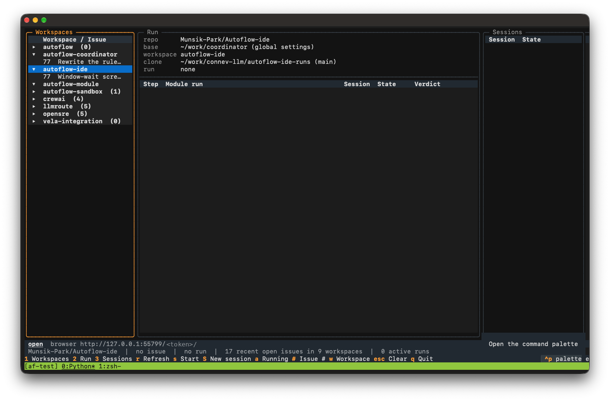

# AutoFlow

AutoFlow takes a development request, given as a GitHub issue, through the steps of development. Each step is a module. A coordination session builds a workflow that fits the issue from the modules, runs each module in a work session, judges what it leaves and connects it to the next module, up to pull requests ready for your decision.

Because a step is a module, a step can be replaced. A module you make yourself is listed beside the default modules, and one with a default module's name is used in its place. The workflow then fits your repository and your way of working.


## The three repositories

AutoFlow is three repositories used together.

| Repository | Place |
|---|---|
| [autoflow-module](https://github.com/Munsik-Park/autoflow-module) | The modules. Each is a folder holding one `SKILL.md` that defines a step, such as analysis, design, build and review. It also holds the skill that makes a user module. |
| [autoflow-coordinator](https://github.com/Munsik-Park/autoflow-coordinator) | The coordination session and its tools. It assembles modules into a workflow, opens work sessions and judges their results. |
| [autoflow-ide](https://github.com/Munsik-Park/Autoflow-ide) | The screen over the coordinator: issues, runs and sessions in one terminal UI. |

## What it looks like

The IDE, started with `--coordinator`, lists every workspace with its recent open issues on the left. The middle shows the chosen issue's repository, workspace and run, and the steps of the run; the right shows the run's sessions. The status line shows the browser control address and the counts of issues and active runs, and the keys are at the bottom.


## Quick start

The steps below set AutoFlow up on one machine and run one issue from the IDE. Each repository's README has the full details; this section gives the commands in order.

### 1. Requirements

- Claude Code, with `claude` on `PATH`.
- tmux. Open it in a window at least 110 columns wide and 40 rows high. Checked on macOS; the macOS default terminal (Terminal.app) is not supported.
- `git` 2.37 or later, `python3` 3.9 or later (3.10 or later for the IDE's browser control), `jq`, `uuidgen`, OpenSSH `ssh-keygen`, and `gh`, signed in.
- For the review module's reviewers: `codex`, signed in.
- A fine-grained GitHub token for each repository you work on, without the Administration permission.

The full list is in [autoflow-coordinator > Requirements](https://github.com/Munsik-Park/autoflow-coordinator#requirements).

### 2. Install

Clone the three repositories side by side, outside the folder that will hold your workspaces:

```bash
mkdir -p ~/work && cd ~/work
git clone https://github.com/Munsik-Park/autoflow-coordinator.git
git clone https://github.com/Munsik-Park/autoflow-module.git
git clone https://github.com/Munsik-Park/Autoflow-ide.git autoflow-ide
```

Tell the coordinator where the modules and the workspaces are, in `~/.autoflow/coordination.json` (for every clone) or in `coordination.local.json` at the root of the coordinator clone (for that clone):

```bash
mkdir -p ~/.autoflow
cat > ~/.autoflow/coordination.json <<'EOF'
{
  "modules": "~/work/autoflow-module",
  "base": "~/work/coordinator"
}
EOF
~/work/autoflow-coordinator/tools/config.py      # prints each setting and where it came from
```

`base` is where workspaces are kept, one folder per repository you work on. The other keys are in [autoflow-coordinator > Settings](https://github.com/Munsik-Park/autoflow-coordinator#settings).

Install the IDE in a virtual environment:

```bash
cd ~/work/autoflow-ide
python3 -m venv .venv
source .venv/bin/activate
pip install -e '.[browser]'      # or: pip install -e .   (without browser control)
```

### 3. Check the terminal

Once per machine and terminal, from a tmux window in the coordinator clone:

```bash
cd ~/work/autoflow-coordinator
tools/terminal_check.py
```

It opens short Claude Code sessions in panes below, prints `PASS` or `FAIL <why>` for each item, then closes them. Run it again after updating the terminal.

### 4. Start the IDE

```bash
tmux new -s autoflow
source ~/work/autoflow-ide/.venv/bin/activate
autoflow-ide --coordinator ~/work/autoflow-coordinator
```

The left pane lists every workspace under `base` with its most recent open issues. The keys are at the bottom of the screen:

| Key | What it does |
|---|---|
| `w` | Add a workspace for a repository (`owner/name` or its GitHub address) |
| `s` | Start a run for the highlighted issue |
| `S` | Open another coordination session for the same issue |
| `#` | Find an issue by its number |
| `a` | Show only the issues with a run |
| `1` `2` `3` | Move between the workspaces, run and sessions panes |
| Enter | On a step: open what it left. On a session: move tmux focus to it |
| `b` | Start or stop browser control (the same screen in a web browser) |
| `r` / `q` | Reload the issues / quit |

### 5. Add a workspace

Press `w` and give the repository, for example `owner/name`. A coordination session opens in a new tmux window and asks for the local clone and the base branch, then writes the workspace under `base`. When it asks for the token, write it from your own shell, so it does not pass through the conversation:

```bash
(umask 077; read -rs T; printf '%s\n' "$T" > ~/work/coordinator/<workspace>/gh-token)
```

A workspace can also be written by hand: [autoflow-coordinator > Workspaces](https://github.com/Munsik-Park/autoflow-coordinator#workspaces).

### 6. Run an issue

1. Move to an issue and press `s`. Type a line of instructions for the run, or nothing, and Enter.
2. A tmux window `<workspace>#<issue>` opens with the coordination session. It reads the issue and presents a workflow outline. Approve it, or ask for changes, in that window.
3. The coordination session opens work sessions in panes below it and runs the modules one by one. The IDE shows the steps, their verdicts and the sessions; a `?` beside an issue means a session waits for your answer.
4. When the pull requests are ready, it gives you a merge review artifact and asks which to accept. You give your decision with `tools/approve.py` in your own terminal, as described in [autoflow-coordinator > First run](https://github.com/Munsik-Park/autoflow-coordinator#first-run).

### Without the IDE

The IDE starts the coordination session the way you can by hand. In tmux, in the coordinator clone:

```bash
cd ~/work/autoflow-coordinator
GH_TOKEN=$(cat ~/work/coordinator/<workspace>/gh-token) claude
```

Then tell it the workspace and the issue, for example `Work on issue 123 in workspace my-repo.`

## Useful commands

Run in the coordinator clone.

| Command | What it shows |
|---|---|
| `tools/config.py` | The settings in effect and where each came from |
| `tools/modules.py` | The modules a coordination session can choose from, default and user |
| `tools/status.py` | Where each active run stands, as JSON |
| `tools/usage.py <run-dir>` | Tokens and cost of a run's sessions |

Each run keeps its data under the coordinator's `root` (`~/.autoflow/coordination` by default): `runs/<run>/` for the run and `records/<run>/` for what each module run left.

## Making a user module

In a Claude Code session opened in the autoflow-module clone:

```
/make-user-module <what the module is to do>
```

It drafts the module with you and writes it to `~/.autoflow/modules/<name>/SKILL.md`. A user module with a default module's name is used in its place. Details: [autoflow-module > Making a user module](https://github.com/Munsik-Park/autoflow-module#making-a-user-module).

## Reading further

A person or an AI session setting AutoFlow up reads the README of each repository in this order.

1. **autoflow-coordinator**: its requirements, install steps, workspaces and first run. The install steps include cloning autoflow-module.
2. **autoflow-ide**: how to start the IDE over the coordinator clone.
3. **autoflow-module**: the list of modules, and how to make a user module.

## Changes

Which versions of the three repositories go together, and what changed between versions, are in [CHANGELOG.md](CHANGELOG.md).
