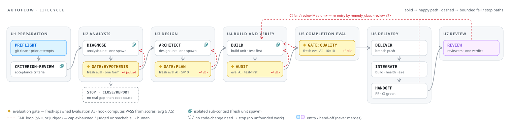
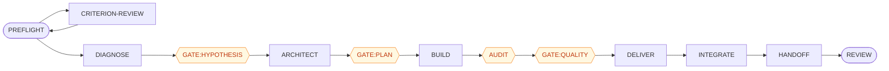

# Claude AutoFlow

A reusable framework for structured, evaluation-gated AI-assisted software development with [Claude Code](https://docs.anthropic.com/en/docs/claude-code), delivered as a Claude Code plugin.

AutoFlow is a development lifecycle of seven functional units (PREFLIGHT → REVIEW) built on
multi-agent role separation, independent analysis, and quantified evaluation
gates. Your project installs the plugin and runs its cycle; AutoFlow writes no file
into the project's tree (see [Quick Start](#quick-start)). Three properties set its scope:

1. **Terminal scope** — AutoFlow ends at the hand-off of the reviewed PR (`REVIEW`); an external review process performs the merge. **AutoFlow never merges.**
2. **Late-gate re-entry** — a late-gate FAIL (GATE:QUALITY, INTEGRATE, HANDOFF CI) re-enters the cycle at the point its cause names (`remedy_class`: doc commit / BUILD / ARCHITECT).
3. **Functional units** — DIAGNOSE, ARCHITECT and the build span (BUILD, AUDIT) each run as one unit agent prescribed by its goal, artifacts and verification (ADR-0025).

A project without sub-repos is the plain case (DELIVER
pushes one branch, HANDOFF opens one PR).

---

## What Is AutoFlow?

AutoFlow structures every code change through a defined lifecycle:

```
PREFLIGHT       Preparation (U1)  — prior-attempt resolution, Git clean check, sync, entry, state creation
CRITERION-REVIEW Criterion review (U1) — the attempt's review of the issue's acceptance criteria against the code and policy; on its [criterion-ready] entry, back to PREFLIGHT, whose stop conditions and state file come before DIAGNOSE
DIAGNOSE        Analysis unit (U2) — Current structure, gap, necessity, conclusion with its grounds
GATE:HYPOTHESIS Analysis Eval     — Scored analysis assessment (one form: conclusion grounds, goal coverage)
ARCHITECT       Design unit (U3)  — Feature design + verification design
GATE:PLAN       Plan Evaluation   — Scored plan assessment (gate)
BUILD           Build unit (U4)   — Test-first implementation and verification
AUDIT           Security Audit    — Independent test-first judgment and project-specific security audit
GATE:QUALITY    Completion Eval   — Scored quality assessment (gate)
DELIVER         Push              — the orchestrator's own `git push` (a changed sub-repo's branch too)
INTEGRATE       Integration Test  — the change shown working above its own tests: the system build, health check and functional test, or the project's integration suite
HANDOFF         PR + CI           — PR creation by the orchestrator's own commands → CI green
REVIEW          Review (U7)       — the configured reviewers, each run by its own script, and the target's own review bots → one aggregated verdict → review triage → hand-off with the merge order; external review merges out of band (AutoFlow does not merge)
```

The happy-path flow at a glance (regression edges and human-escalation paths
are omitted; see [`docs/autoflow-guide.md`](docs/autoflow-guide.md) for the
full diagram):

<picture>
  <source media="(prefers-color-scheme: dark)" srcset="docs/assets/autoflow-lifecycle-dark.svg">
  
</picture>

<details>
<summary>Text source (Mermaid)</summary>



</details>

> The SVG pair above is generated by
> [`docs/assets/render-lifecycle-svg.py`](docs/assets/render-lifecycle-svg.py)
> — edit the script and re-run it; never edit the SVGs by hand.

### Key Features

- **Multi-Agent Roles** — Orchestrator, functional-unit agents (analysis, design, build), Evaluation AI and advisor with separated responsibilities.
- **Analysis unit** — one analysis spawn states the current structure as fact, the gap to the request and whether code is the lever, heeding stated bias cautions; a fresh evaluator scores it.
- **Evaluation Gates** — 10-point scoring system with a defined PASS threshold (≥ 7.5, each ≥ 7, security ≤ 3 → block).
- **Hook Enforcement** — A shell hook validates AutoFlow state before allowing Agent spawns, `git push`, or `gh pr create`.
- **Sub-Repo Support** — a changed sub-repo is delivered on its own PR and the host follows it by its pointer; the project's structure is read from its own information, not classified.

---

## Quick Start

AutoFlow is a **versioned tool your own dev project consumes**, delivered by a
Claude Code plugin alone: your project is the repository Claude Code runs in, and
AutoFlow writes no file into it: its records live under a record root outside
every project's tree (`~/.autoflow` by default).

Install the plugin once per machine, at user scope:

```
/plugin marketplace add Munsik-Park/autoflow
/plugin install autoflow@autoflow
```

`/plugin install` writes the enablement into `~/.claude/settings.json`, which
turns AutoFlow on in every project you open. To keep it **off** in one
repository, write `"enabledPlugins": {"autoflow@autoflow": false}` into that
repository's `.claude/settings.json`.

Then, in your project:

- **Run an issue** with `/autoflow:cycle <issue>`: with no attempt of the
  issue left in this checkout, it creates one — its dev branch, checked out,
  and its record directory — and its first stage reviews the acceptance
  criteria ([`docs/criterion-review.md`](docs/criterion-review.md)) before
  the cycle goes on to DIAGNOSE. With an attempt of the issue still here (an
  open PR, a pause, a review not finished), it enters or reports that one;
  `/autoflow:cycle <issue> new` asks for a new attempt beside it.
  `/autoflow:criterion-review <issue>` runs the review stage alone, and
  `/autoflow:cycle-u1 <issue>` … `/autoflow:cycle-u6 <issue>` and
  `/autoflow:cycle-u7 [<issue>]` run one unit in a session of its own, with the parts of the core that unit uses. Several
  attempts at one issue — in this checkout, other worktrees or other clones —
  run side by side; each is the checkout's that began it.
- **Nothing to ignore**: every record — an attempt's state, ledger, reports and
  cycle-layer store, issue drafts — is under the record root,
  `<record-root>/<repo-key>/<stamp>-issue-<N>/` per attempt (`autoflow-records
  dir` prints it). Set `"record_root": "<absolute path>"` in
  `~/.autoflow/config.json` to move it; the file stays where it is. A project
  whose records are still in its own `.autoflow/` from an earlier release moves
  them with `scripts/migrate/migrate-in-tree-records.sh`
  ([`docs/state-tracking.md`](docs/state-tracking.md) > *Record location*).
- **Your reviewers are set once, for every project**, in
  `~/.autoflow/config.json`. AutoFlow's SessionStart hook creates it on the
  first session start in any project where the plugin is enabled — only when it
  is absent, outside your project's tree — with
  `{ "review": { "reviewers": [] } }` and tells you so. With no reviewer named,
  the default reviewers, `claude` and `codex`, review every pull request at
  REVIEW; list the reviewers there to choose them, and each one's model, effort,
  rule file and lenses file ([`docs/reviewer-backend.md`](docs/reviewer-backend.md) >
  *Config location*). A broken file is reported, and you are asked whether to
  go on without those reviewers.
- **Declare what your project needs** in `.claude/autoflow.local.json` — the
  file is yours, and absent means none of the following
  ([`.claude/autoflow.local.json.example`](.claude/autoflow.local.json.example)):
  - `preflight.local_checks[]` — your own per-clone readiness steps, run at
    PREFLIGHT ([`docs/units/preparation.md`](docs/units/preparation.md) > *Stop conditions*);
  - `audit.security_checklist` — the repository-relative path of your security
    checklist, which AUDIT scores a change against ([`docs/units/build.md`](docs/units/build.md) > *Security checklist*);
  - `tests.suite_plane` — `true` only to adopt AutoFlow's suite plane.
- **Optionally own the spawn policy**: a `.claude/autoflow/spawn-policy.json` in
  your project overrides the plugin's default model per phase
  ([`docs/tool-delivery-contract.md`](docs/tool-delivery-contract.md) > *Spawn policy*).
  The `advisor` row ships on `fable`; an account without Fable access changes
  that row's `model` there.

**Updating** is the plugin update alone: `/plugin marketplace update` →
`/plugin update autoflow@autoflow`. Every cycle records in its ledger which
AutoFlow ran it — the plugin version, the loaded root and, for a checkout, its
`HEAD` — and PREFLIGHT stops on a failed **target check**: your own spawn policy
against the loaded agent definitions, and, on an opted-in target, the suite
headers (`<autoflow-root>/scripts/preflight/target-check.sh`).

**Developing AutoFlow**: `claude --plugin-dir <clone>` runs a clone's working
tree in place of the installed plugin for that session.

**Prerequisites**: Claude Code v2.1.277+, `jq` and the GitHub CLI `gh`; a GitHub
repository (one per sub-repo, for a project with sub-repos).

---

## Repository Structure

```
autoflow/
│
├── README.md
├── CLAUDE.md                          # Notes for developing AutoFlow itself (the core is docs/core.md)
│
├── .claude-plugin/                    # plugin.json + marketplace.json — the repository root is the plugin root (ADR-0027 D1)
├── agents/                            # AutoFlow role subagent definitions
├── hooks/                             # Gate hook (check-autoflow-gate.sh), read-dedup hook, user-config SessionStart hook (ensure-user-config.sh: creates ~/.autoflow/config.json when absent, in every project), hooks.json
├── skills/                            # /autoflow:cycle, /autoflow:cycle-u1 … cycle-u7 — one unit — and /autoflow:criterion-review — its criterion review stage alone (generated from docs/core.md and the documents scripts/skills/role-docs.tsv names)
├── bin/                               # autoflow-root — prints the plugin root; autoflow-records — the record root, an attempt's record directory, a new attempt
│
├── .github/
│   └── workflows/                     # Advisory CI guards (.github/workflows/)
│
├── docs/                              # Usage documents — carried by each role's carrier where its role follows them, otherwise read by path under the plugin root
│   ├── INDEX.md                       # Router: usage documents vs records
│   ├── core.md                        # The core: cross-unit invariants and authority rules
│   ├── autoflow-guide.md              # Lifecycle overview + index of the unit documents
│   ├── evaluation-system.md           # Evaluation scoring details
│   ├── git-workflow.md                # Git procedures
│   ├── repo-boundary-rules.md         # Cross-repo coordination rules
│   ├── submodule-common-rules.md      # Sub-repo shared rules
│   ├── role-common-rules.md       # Shared role-spawn behavior rules
│   ├── security-checklist.md          # This repository's own security checklist (declared in .claude/autoflow.local.json)
│   ├── units/                         # Functional-unit documents, U1–U7 (docs/units/)
│   └── records/                       # Design & decision records — the source of no rule
│       ├── design-rationale.md        # Why every rule exists — read for a decision's grounds, routed per role
│       ├── adr/                       # Architecture Decision Records
│       └── design-reviews/            # Design reviews behind the ADRs
│
├── scripts/                           # Helper / handoff scripts (scripts/)
└── tests/                             # Guard & regression suites (tests/)
```

---

## How It Works

### 1. The Core Drives AI Behavior

[`docs/core.md`](docs/core.md) is the operating manual: the AutoFlow lifecycle
and rules, agent roles and permissions, evaluation criteria, and the Git
workflow. It reaches a session through the body of `/autoflow:cycle` (a unit's
`/autoflow:cycle-u1` … `/autoflow:cycle-u7` carry the parts its unit uses, and
`/autoflow:criterion-review` the cycle's criterion review stage alone), and a subagent through its agent definition; each
command body carries its unit's document and the other documents the session follows after the
core, and each agent definition the core parts and documents its role follows (ADR-0035).

### 2. Multi-Agent Separation

| Agent | Role | Can Write To |
|-------|------|--------------|
| **Orchestrator** | Coordinates, delegates | Host repo (rules, config, infra, bulk docs) |
| **Build unit (U4)** | Implements and verifies the design per target scope, test-first | Files within the assigned scope |
| **Evaluation AI** | Scores quality | Nothing (read-only) |

### 3. Evaluation Gates

At GATE:HYPOTHESIS, GATE:PLAN, AUDIT, and GATE:QUALITY, a freshly spawned
Evaluation AI scores the work. PASS = average ≥ 7.5, each item ≥ 7, security
score ≤ 3 → automatic rework. Categories and weights are customisable per
project.

### 4. Hook Enforcement

`check-autoflow-gate.sh` reads the state files of the session checkout's
attempts, `<attempt-dir>/issue-{N}.json`, to prevent Agent
spawns, `git push`, and `gh pr create` from running before the corresponding
gate has passed. The hook computes verdicts directly from raw `scores` — it
never trusts an AI-supplied `pass` field.

---

## Customization

### Repository Structure

AutoFlow does not classify a project's repository structure. The AI reads the
project's own information and rule files where they exist — a `README.md`, a
`CLAUDE.local.md`, or whatever the project keeps — for the facts the work needs
(see `docs/core.md` > Project Information), and asks the operator for a fact no
file states. A project with sub-repos delivers each changed sub-repo on its own
PR and keeps the host's pointer clean by a reconcile merge after the sub-repo PR
merges (`docs/units/delivery.md` > *Multi-repo delivery*).

### Evaluation Tuning

- Adjust category **weights** to match your priorities.
- Adjust the **PASS threshold** in both `docs/core.md` and `check-autoflow-gate.sh`.
- Add **custom categories** as needed.

---

## Documentation

| Document | Description |
|----------|-------------|
| [**Design Rationale**](docs/records/design-rationale.md) | Why every design decision was made — a record read for a decision's grounds; which documents a role receives is routed per role (`docs/core.md` > Context Injection — Role-Scoped Document Routing) |
| [AutoFlow Guide](docs/autoflow-guide.md) | Lifecycle overview and diagram; index of the functional-unit documents (`docs/units/`) |
| [Evaluation System](docs/evaluation-system.md) | Scoring, PASS criteria, output format |
| [Git Workflow](docs/git-workflow.md) | Branch naming, commits, PR process |
| [Repo Boundary Rules](docs/repo-boundary-rules.md) | Cross-repo coordination |
| [Sub-Repo Common Rules](docs/submodule-common-rules.md) | Sub-repo rules, verification and reporting |
| [Security Checklist](docs/security-checklist.md) | This repository's own security items — a target declares its own checklist (`docs/units/build.md` > *Security checklist*) |
| [Tool Delivery Contract](docs/tool-delivery-contract.md) | The plugin as the single version, the target-owned files, the spawn policy, the runtime environment |

---

## Contributing

1. Fork this repository.
2. Create a feature branch (`feature/your-change`).
3. Follow the existing documentation style.
4. Submit a PR with a clear description.

---

## License

This project is licensed under the **Apache License 2.0** — see
[`LICENSE`](LICENSE) and [`LICENSES/Apache-2.0.txt`](LICENSES/Apache-2.0.txt).

Licensing metadata follows the [REUSE 3.3](https://reuse.software) specification:
every tracked file carries an SPDX header or is covered by [`REUSE.toml`](REUSE.toml),
and `reuse lint` is enforced in CI.
